# 小黑屋 · 纯离线 Android 中文版

**纯 AI 项目**：本仓库的 Android 封装、移动端适配、附加功能、测试脚本、文档与发布整理，均由 AI 根据用户需求和反馈完成。游戏原作、上游代码、翻译、音效及第三方库来自各自原作者，署名与许可保留，不能将这些上游成果归为 AI 原创。

基于 [doublespeakgames/adarkroom](https://github.com/doublespeakgames/adarkroom) 的非官方安卓移植。游戏和资源全部装在 APK 中，固定简体中文，安装后可直接断网游玩。

[下载最新版 APK（1.3.2）](https://github.com/kirimarisadaze/a-dark-room-offline-android/releases/latest/download/a-dark-room-offline-1.3.2.apk) · [全部版本](https://github.com/kirimarisadaze/a-dark-room-offline-android/releases) · [更新记录](CHANGELOG.md) · [反馈问题](https://github.com/kirimarisadaze/a-dark-room-offline-android/issues)

**1.3.2 撤离与整备修复**：地牢缺补给时可确认受伤撤离，避免被补给门槛困住；无实际变化的整备不耗回合，也不能重复将水井备用水刷入仓库。菜单区分暂离与返回，说明自动保存，建造、制造与研究按钮增加明确的无障碍名称。保留独立临时储物、群系、同行者与封锁据点。玩法与验证范围见 [生存模式说明](docs/ROGUELIKE.md)。

| 项目 | 说明 |
| --- | --- |
| 当前版本 | **1.3.2**，versionCode **21** |
| 应用名称 / 包名 | 小黑屋 · 离线 / `org.adarkroom.offline` |
| 运行要求 | Android **6.0+**，Android System WebView **80+** |
| 语言 | 安装包仅含简体中文 |
| 联网与权限 | 无 `INTERNET` 权限，无存储读写权限，无运行时权限请求 |
| 存档 | 每模式 3 个独立栏位，自动保存，支持当前存档备份 / 恢复 |
| 许可 | [MPL-2.0](LICENSE.md)，保留上游及第三方署名 |

AI 继续维护前请先阅读 [AI_README.md](AI_README.md)，其中记录界面、玩法、存档隔离与发布约定。

## 目录

- [安装与升级](#安装与升级)
- [功能与操作](#功能与操作)
- [界面预览](#界面预览)
- [存档与备份](#存档与备份)
- [完全离线如何实现](#完全离线如何实现)
- [从源码构建](#从源码构建)
- [测试与验证范围](#测试与验证范围)
- [版本与源码归档](#版本与源码归档)
- [常见问题](#常见问题)
- [目录结构](#目录结构)
- [来源、许可与贡献](#来源许可与贡献)

## 安装与升级

1. 从 [最新 Release](https://github.com/kirimarisadaze/a-dark-room-offline-android/releases/latest) 下载 `.apk`，无需下载源码包。
2. 把 APK 保存到安卓手机，允许当前浏览器或文件管理器“安装未知应用”，打开安装。
3. 启动“小黑屋 · 离线”。首次启动也不需要网络、账号、服务器或额外资源下载。
4. 安装后可开启飞行模式游玩。旧系统如使用过旧的 WebView，请在断网前先将其更新到 80 或以上。

本项目发布的各版包名与签名一致，可直接覆盖升级并保留本机存档。升级前建议先导出一份存档。其他作者的安卓版可能使用不同的包名、签名和存档位置，需要先导出兼容的存档代码再导入。

最新版 **1.3.2** 安装包约 **5.5 MiB**；SHA-256：

```text
71d7b40403a6471e4ae4404375820cd9e13851f9ef8f89bec1bf1c27f4aff076
```

Release 附有同名 `.sha256`。Windows 可用以下命令检查下载文件：

```powershell
Get-FileHash .\a-dark-room-offline-1.3.2.apk -Algorithm SHA256
```

## 功能与操作

### 主页面与模式选择

打开应用先进入主页面，点击“开始游戏”后选择模式：

- **普通模式**：先选择存档 1 / 2 / 3；已有进度可继续，空栏位从头开始。
- **生存模式「无光之地」**：选择三段独立旅程之一，输入世界种子或随机开始，探索九片荒野、经营据点、挑战回合制战斗与地牢，制造飞船通关后解锁深渊。

主页面沿用原作黑白文字与细线按钮的风格，跟随已保存的日夜主题和字号。停留在主页或选择旅程不会启动普通游戏引擎、推进生产，也不会建立 Rogue 存档。首次打开普通模式存档选择时会保留并迁移旧版进度。游戏菜单内可“返回主页面”；Android 返回键按界面层级关闭弹窗或打开游戏菜单。

### 生存模式：无光之地

- 固定顶部标题，手机底部提供返回、探索、据点、队伍和菜单，大屏同时显示三栏；延续原作日夜配色、细线、直角按钮和文字排版，字符地图使用等宽字体。
- 底部持续显示天数、时段与当日回合进度，可点击查看时间说明；每次有效行动推进时间，查看与停留不耗时。可点击方向键或用方向键 / WASD 行走，空格休息；菜单中选择过夜推进 25 / 50 / 100 回合。
- 从收集周围物资、制造长矛开始。清理并占领资源点后派村民生产。全世界最多两处永久据点：开局随机一处，第二处由玩家建造；两者共用仓库。营地包可搭建短期休整点，远行备足水与口粮。
- 同行者可独立换装、携带 24 格物资；在据点解除同行时，居民归队，物品存回共享仓库。武器可卸下、逐件存取，同类备用武器不会叠加攻击。
- 六种群系影响每步耗水与际遇权重，商人只收随身物资；每片区域有一处封锁据点，三轮守卫战和两间搜寻房间后可修复收编，超过全世界两处名额时明确确认替换第二处。
- 招募同行者、研究科技、下地牢寻找图纸，制造船体、推进器、能量核心，到第九区域组装飞船。通关后可进入不产出资源、死亡无损失的深渊挑战。
- 每次行动保存，刷新可继续当前战斗。三段旅程独立，发现的图纸跨旅程保留；普通模式进度不变。Android 菜单可备份或恢复当前旅程。
- 据点总览通过分类入口进入人手、建造、制造、研究等子页，长列表分页；地图只记录探索过的区域，用当地线索提示方向。二级页面底部提供标明目的地的返回按钮，退出主页需确认；指南、手记与菜单按原层级返回，保留滚动位置。详细操作见 [生存模式说明](docs/ROGUELIKE.md)。

### 普通模式：手机界面

- 顶部标签切换已解锁场景；在场景空白处左右滑动也可切换。竖向滑动用于滚动，地图、飞船、按钮和弹窗区域使用各自的操作。
- 建筑、制作、交易、制造与飞船升级在点击前直接显示材料需求和缺少数量，卡片尺寸稳定，分类可折叠。
- 仓库采用紧凑名称 / 数量表；大数量显示“万 / 亿”，内部计算和存档保留完整数值。
- 村民管理汇总总人数、已分工人数和自动伐木人数，可每次增减 **1 人 / 10 人**，职业旁直接显示产出与消耗。
- 事件、消息历史和战斗居中显示；战斗采用紧凑弹窗，武器多时攻击区单独滚动，治疗操作保持可见。
- 底部“菜单”集中提供日夜主题、**16–22px** 字号、声音、存档与其他设置；前台游玩时保持屏幕常亮。

### 普通模式：探索与收获

- 探索方向键为十字布局：点击走一格，按住连续走，按住后滑向其他方向可直接换向。
- 松手、移出按键、触摸取消或触发事件时停止；事件出现后松手不会误点弹窗。
- 附近地图跟随 `@` 玩家位置，可切换为可滚动的全图。
- 收获页显示背包余量、地面剩余数量、单件 / 整组拾取；“全部拾取”和继续 / 离开分开操作。
- 背包满时可在物品下方选择换出物品；换出的物资仍可从地上拾回。
- 飞船支持屏幕方向键和左右倾斜；没有传感器时也能使用方向键。

### 普通模式：可调速度

“菜单 → 游戏速度”可选择 **1 / 2 / 3 / 4 倍**，设置随存档保存。倍率影响生产、人口与事件等待、战斗计时和操作冷却，中途修改保留已等待的进度。飞船操控和声音保留独立计时。上游旧存档的加速模式会转换为 2 倍。

### 普通模式：可选作弊模式

作弊默认关闭，在菜单中主动打开后可使用：

| 功能 | 效果 |
| --- | --- |
| 常用物资 +1000 | 添加常用物资 |
| 恢复生命与水 | 补充当前探索的生命与水 |
| 行动免冷却 | 清除 / 跳过操作冷却，仍检查材料与建造上限 |
| 探索保护 | 保护探索与战斗中的生命和水，行走不消耗食物；不作用于飞船 |
| 地图全开 | 解锁“漫漫尘途”后，一次揭开并保存整张地图的迷雾 |

开启时底栏显示“作弊已开”。关闭总开关后恢复正常规则，已经添加的物资和已经揭开的地图会保留。

地图全开同时更新当前出征和已保存的地图迷雾，探索失败、关闭作弊或重启应用后仍保留；不会移动角色、提前完成地标、领取奖励或提交尚未带回的探索成果。

### 普通模式：地标图鉴

普通模式也可使用，从菜单或地图旁打开。图鉴收录 **19 种地标 / 地形符号及玩家标记 `@`，共 20 项**，提供中文用途说明，支持按名称、符号或说明内容搜索。解锁地图后显示当前已揭开区域的数量；地点清理后变成哨站时按当前符号统计。查阅不会揭开迷雾，输入搜索内容也不会控制背后的角色。

## 界面预览

以下为离线浏览器自动化测试中生成的游戏画面，使用后期测试存档；并非手机实拍，可能包含剧情与后期装备信息。各图取自对应功能完成时的版本。

<table>
  <tr>
    <td align="center">主页面<br>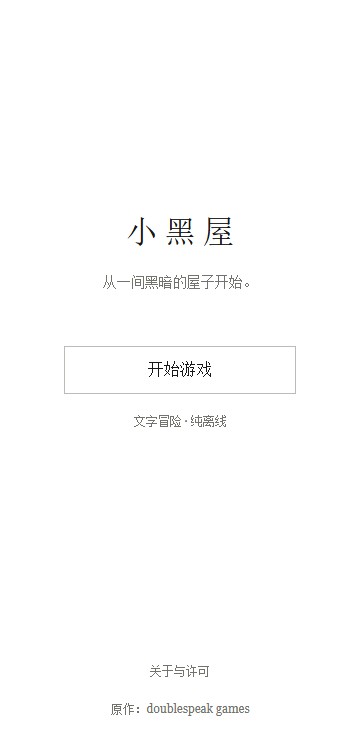</td>
    <td align="center">模式选择（1.0.14）<br>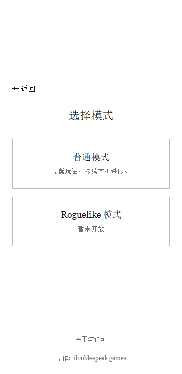</td>
    <td align="center">独立存档<br>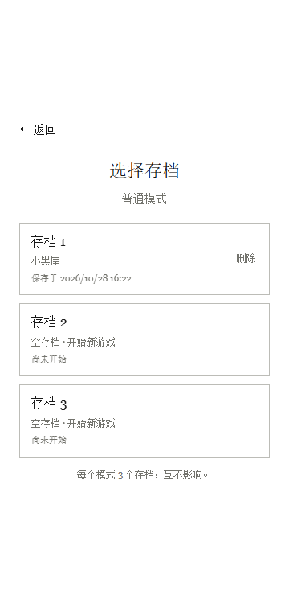</td>
  </tr>
  <tr>
    <td align="center">材料需求<br>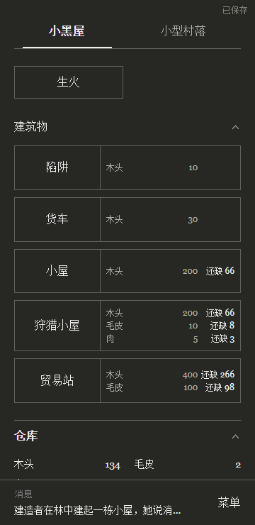</td>
    <td align="center">村民管理<br>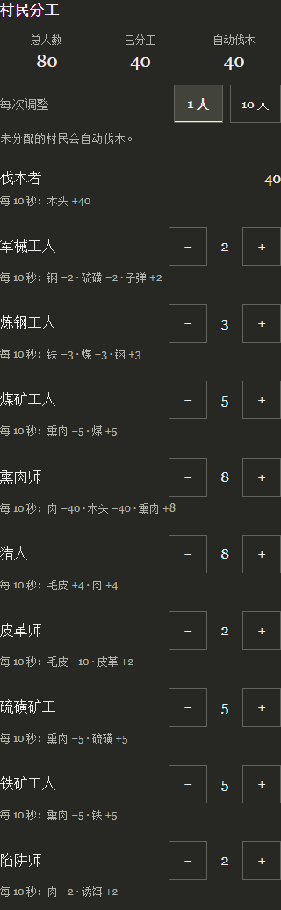</td>
    <td align="center">地图探索<br>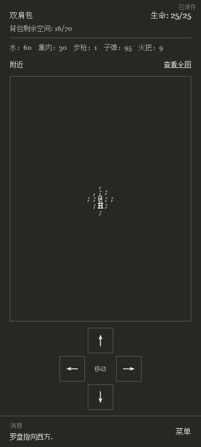</td>
  </tr>
  <tr>
    <td align="center">收获与背包<br>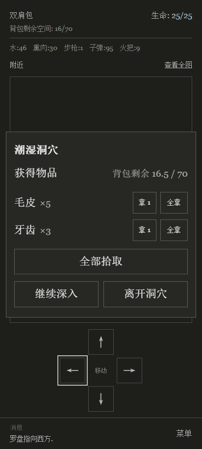</td>
    <td align="center">紧凑战斗<br>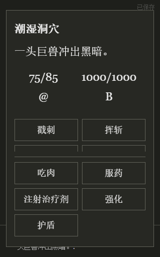</td>
    <td align="center">中文地标图鉴<br>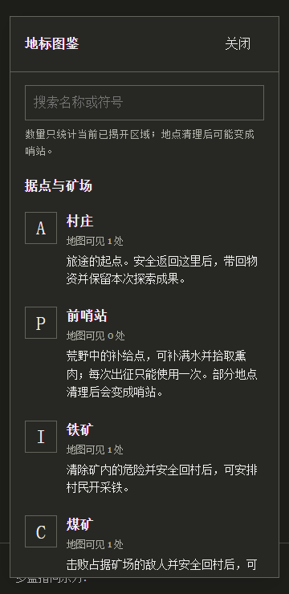</td>
  </tr>
</table>

「无光之地」界面（浏览器自动化截图；下列高屏与储物图为 1.3.1，其余为 1.3.0）：

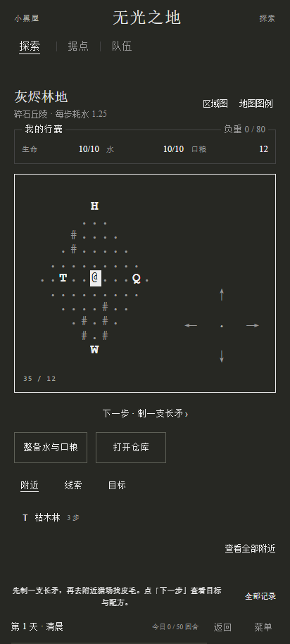 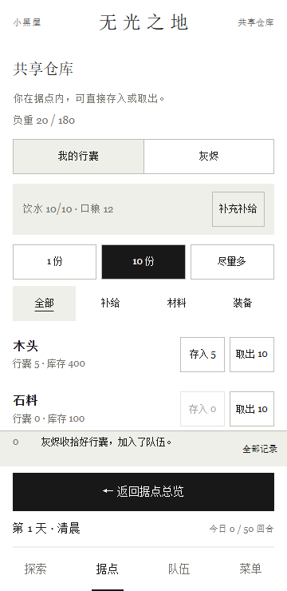 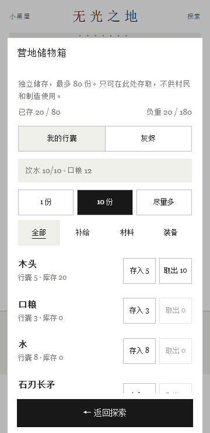

<table>
  <tr>
    <td align="center">日间探索<br>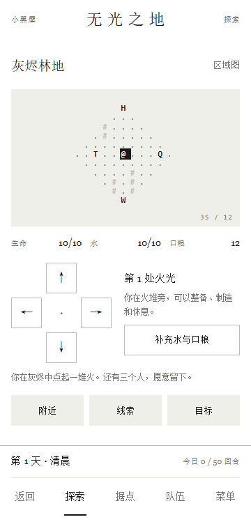</td>
    <td align="center">分层据点总览<br>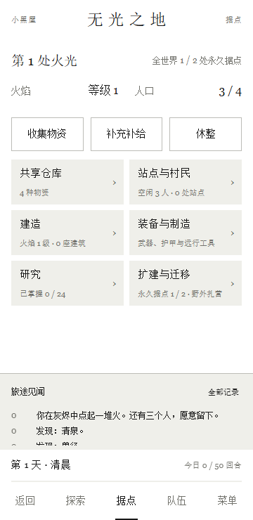</td>
    <td align="center">夜间回合战斗<br>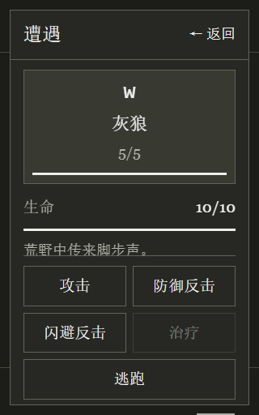</td>
  </tr>
  <tr>
    <td align="center">装备与行囊<br>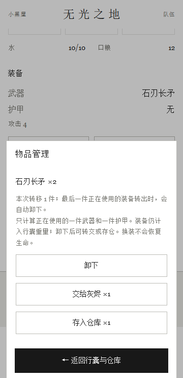</td>
    <td align="center">旅程结束<br>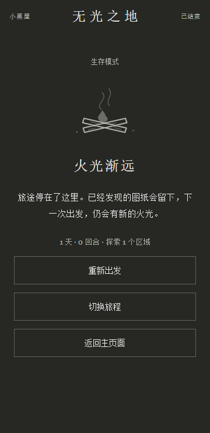</td>
    <td align="center">飞船结局<br>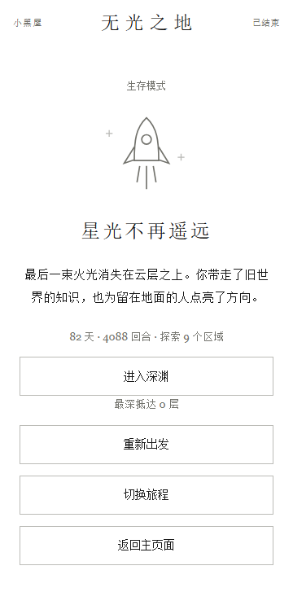</td>
  </tr>
</table>

二级页面的底部返回按钮：

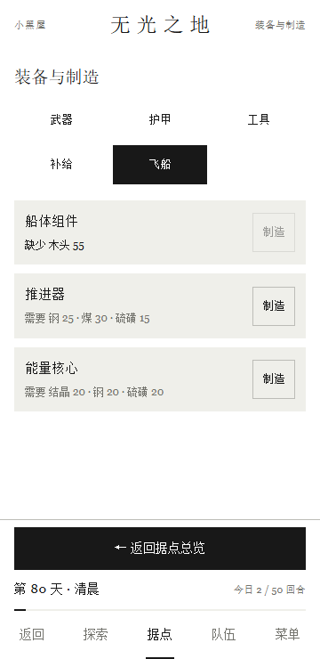 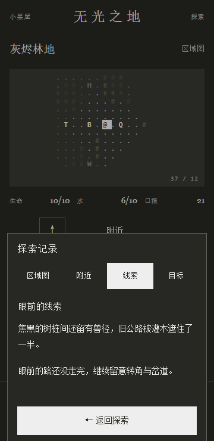

## 存档与备份

游戏自动保存在应用内部；切到后台和按返回退出时也会保存。

“开始游戏 → 选择模式 → 选择存档”，每个模式各有 **3 个独立栏位**。普通模式的栏位显示当前进度摘要与保存时间，空栏位点击后开始新游戏。旧版单存档会原样迁入**普通模式的存档 1**，其他栏位保持空白。游戏菜单显示当前模式和栏位。

自动保存、文件恢复和游戏内“重新开始”只影响当前选中栏位。存档选择页支持单独删除，需二次确认；取消不会删除。Roguelike 三段旅程使用独立的存储键，进入、行动、刷新、恢复、删除与返回均不改写普通模式存档；已发现的图纸跨旅程保留。

| 操作 | 入口与说明 |
| --- | --- |
| 导出文件 | 菜单 → 备份到文件，通过 Android 系统文件选择器保存当前栏位的 `.adr.txt` |
| 恢复文件 | 普通模式从主页或游戏菜单选择目标；Roguelike 先进入目标旅程，再从菜单恢复；确认后只替换当前栏位 |
| 手动复制 / 粘贴（普通模式） | 菜单 → 存档代码，使用上游兼容的 Base64 存档代码；Roguelike 使用自己的备份格式 |
| 迁移手机 | 旧手机导出文件，再在新手机导入 |

卸载应用、清除应用数据会移除所有本机栏位；请先分别备份需要保留的存档。一次导出只包含当前栏位。应用关闭了系统云备份，存档不会由本应用上传。文件恢复会替换选中栏位，建议先导出该栏位。第三方改版的存档不保证兼容。存储写入失败会提示并保留上一次成功保存的进度，损坏数据不会被静默清空。存储实现和恢复边界见 [存档系统说明](android/SAVE_SLOTS.md)。

## 完全离线如何实现

- APK 自带游戏 HTML、CSS、JavaScript、图片、中文翻译和 **86 个 FLAC 音效**。
- 原生入口通过 `AssetManager` 读取安装包内的 HTML，再用 `loadDataWithBaseURL` 显示。
- 固定的 `https://appassets.androidplatform.net/game/index.html` 是 WebView 的**虚拟本地来源**，用于相对路径和本地存储；资源请求全部由原生拦截器从 APK 返回，不访问这个网站，也不启动 HTTP 服务。
- 构建时移除 CDN、统计与其他联网入口，仅打包简体中文。其他来源的资源、导航、文件访问和明文流量被阻止。
- Android 清单没有联网或存储读写权限。存档文件通过系统文档选择器授权访问。

仓库根目录保留上游原始网页源文件，其中可能仍有原作网页链接；安装包使用的是构建脚本生成的离线资源。修改安卓界面请优先编辑 `android/web/`，不要直接修改会被重新生成的 `android/app/src/main/assets/`。

## 从源码构建

### 环境

目前提供的构建入口面向 **Windows PowerShell**，需要：

- Python **3.10+**。
- JDK **17**。
- Android SDK Platform **35**、Build Tools **35.0.0** 或更新版。
- 测试时另需 Node.js 和 Playwright Chromium；仅构建 APK 不需要 npm、Gradle、Android Studio 或网页服务器。

可以通过 Android SDK 的 `sdkmanager` 预先安装所需组件：

```powershell
sdkmanager "platforms;android-35" "build-tools;35.0.0"
```

### 构建命令

```powershell
git clone https://github.com/kirimarisadaze/a-dark-room-offline-android.git
cd a-dark-room-offline-android
.\build-android.ps1 -JavaHome 'C:\path\to\jdk-17' -AndroidSdk 'C:\path\to\Android\Sdk'
```

脚本也支持 `JAVA_HOME`、`ANDROID_SDK_ROOT`、`ANDROID_HOME`，可用 `-Python` 指定 Python 可执行文件。若 PowerShell 执行策略阻止脚本，可使用仅对本次进程生效的方式：

```powershell
powershell -NoProfile -ExecutionPolicy Bypass -File .\build-android.ps1 -JavaHome 'C:\path\to\jdk-17' -AndroidSdk 'C:\path\to\Android\Sdk'
```

脚本依次生成离线资源、编译 Android 资源与 Java、生成 DEX、对齐、签名并验证。输出：

```text
dist/a-dark-room-offline.apk
dist/a-dark-room-offline.apk.sha256
```

再次验证已有构建：

```powershell
.\build-android.ps1 -VerifyOnly -JavaHome 'C:\path\to\jdk-17' -AndroidSdk 'C:\path\to\Android\Sdk'
```

### 签名与自建版本

首次构建会在 `.local/signing/` 生成独立签名密钥；请私下备份整个目录，后续更新继续使用同一密钥。私钥和密码不在公开仓库或源码压缩包中。

在新电脑直接克隆并生成的密钥与 GitHub Release 的签名不同，因此自建 APK 不能覆盖这里发布的 APK。需要切换时先备份存档，或自行修改包名以便并行安装。不能仅靠相同包名和版本号绕过 Android 的签名检查。

### 打包完整源码

```powershell
python scripts/package-source.py
```

生成 `dist/a-dark-room-offline-source.zip`，排除本地密钥、工具链、中间产物、测试设备、生成资源与 Git 数据。版本号以 `android/app/src/main/AndroidManifest.xml` 为准；根目录 `package.json` 保留上游网页开发工具的元数据。

## 测试与验证范围

Android 界面测试使用断网 Chromium，并将同一虚拟 HTTPS 来源的请求映射到 APK 生成资源，不启动网络服务器。安装测试依赖并准备资源：

```powershell
npm install --no-save --package-lock=false playwright
npx playwright install chromium
python scripts/prepare-android-assets.py
```

运行回归：

```powershell
node scripts/test-offline.mjs
node scripts/test-speed.mjs
node scripts/test-mobile-features.mjs
node scripts/test-ui-details.mjs
node scripts/test-late-game-ui.mjs
node scripts/test-exploration-ui.mjs
node scripts/test-combat-ui.mjs
node scripts/test-map-guide.mjs
node scripts/test-home.mjs
node scripts/test-save-slots.mjs
node scripts/test-rogue.mjs --playthrough
node scripts/test-rogue-survival.mjs
node scripts/test-rogue-storage.mjs
node scripts/test-rogue-issues.mjs
node scripts/test-rogue-storage-ui.mjs
node scripts/test-rogue-survival-ui.mjs
node scripts/test-rogue-playthrough-ui.mjs
node scripts/test-rogue-ui.mjs --soak
node scripts/test-rogue-expansion-ui.mjs
```

也可用 `PLAYWRIGHT_MODULE` 指定已有 Playwright 包的绝对路径。报告与截图保存在 `.local/` 下各脚本对应的目录。

已有验证覆盖 320–412px 窄屏、日夜主题、16 / 22px 字号、存档、离线资源、音效解码、速度、村民管理、材料卡片、移动、收获、战斗、作弊与图鉴。地图 / 图鉴新增 48 个布局场景，战斗 50 个，探索 / 收获 72 个；详情及具体历史回归结果见：

- [功能与界面验证记录](android/VALIDATION.md)
- [布局验证记录](android/LAYOUT_VALIDATION.md)
- [原生资源拦截器验证与限制](android/NATIVE_VALIDATION.md)

所有已归档 APK 已检查签名、包名、版本号及无联网权限。历史原生拦截器与模拟器限制见上述原生验证记录。本轮模型合法行动通关含深渊共 5345 回合；真实按钮从新局执行 4073 次有效行动、4619 次点击，经过九区域、13 处地牢和 74 场战斗，第 4084 回合完成飞船结局，再到达深渊第二层、撤离、刷新并确认返回主页，未注入状态或使用援助，两个普通存档字符串不变。另通过 960 组紧急撤离边界、七组问题专项、十组新增日夜布局，以及既有核心、生存、储物、UI、主页与多存档回归；详情见 [1.3.2 核验记录](docs/QA-1.3.2.md)。**本版未做 Android 真机安装、系统文件选择器和 WebView 实机验证，真人通关时长与长期平衡仍未确认。**

## 版本与源码归档

[Release 页面](https://github.com/kirimarisadaze/a-dark-room-offline-android/releases) 收录 **1.0.0–1.3.2 共 21 版**的 APK 与 SHA-256，每版单独说明改动、保存范围和已知问题。详细索引见 [版本归档](docs/RELEASES.md)，机器可读清单见 [releases.json](docs/releases.json)。

- `v1.3.2`：当前发布版的完整可构建源码，包括独立生存模式、界面与测试；Release 附完整源码 ZIP。`v1.0.12` 起各发布版均保留完整工程。
- `release-archives` 与 `v1.0.0`–`v1.0.11`：从对应 APK 提取的实际网页源码与资源，以及归档说明、许可和校验信息。未保存的历史原生工程不会用新版源码冒充。
- `1.0.0`、`1.0.1`：从保留的原始构建产物恢复，并用原密钥重新签名；不是当时分发 APK 的逐字节备份。
- `1.0.0`–`1.0.3`：存在已知加载问题，标为历史测试版 / Pre-release，建议安装最新版。

构建日期和本次归档发布日期分别记录；Git 历史从本次公开归档开始。后续版本的发布步骤见 [发布维护说明](docs/RELEASING.md)。

## 常见问题

**启动显示网页无法打开、资源无法读取或 HTTP 403？**

先确认使用最新版。早期版本存在 Windows 资源路径和内部启动文档拦截问题，分别在 1.0.3、1.0.4 修复。确认 WebView 80+，升级后完全退出应用再打开。如仍失败，请在 Issue 中提供 Android / WebView 版本、应用版本、报错截图和复现步骤；不要公开个人存档。

**为什么能看到一个 HTTPS 地址？要联网吗？**

该地址是本地 WebView 的固定存储与资源来源，实际内容来自 APK。应用没有联网权限，断网可以启动和游玩。

**提示“应用未安装”或签名冲突？**

确认 Android 6.0+、APK 下载完整。若手机装有同包名的自建或其他签名版本，Android 会拒绝覆盖；先在旧版本备份存档，再决定迁移。正常升级本项目 Release 不需要卸载。

**为什么关闭作弊后物资和地图还在？**

添加物资和揭开地图属于已经写入存档的进度；关闭开关只恢复正常规则。想保留未修改的进度，请在使用作弊前导出存档。

**地图全开按钮为什么不能用？**

需要先正常解锁“漫漫尘途”，再启用作弊模式。图鉴本身不需要作弊。

**能导入原版存档吗？**

支持上游兼容的 Base64 存档代码与 `.adr.txt`。导入会替换当前进度，第三方改版的扩展格式不保证兼容。

**为什么源码有其他语言，应用却不能切换？**

仓库保留完整上游翻译；构建脚本只复制简体中文并锁定语言，其他翻译不会进入 APK。

**声音不响？**

先检查游戏声音设置和手机媒体音量，并进行一次游戏操作。旧 WebView 的音频支持可能不同，请使用更新的 WebView。

## 目录结构

```text
android/
  app/src/main/          Android 清单、Java 入口、原生主题与图标
  web/                   独立编写的移动端样式、离线逻辑、中文补充
  tests/                 Android 原生测试框架
  UPSTREAM.md            上游来源与改动署名
  *VALIDATION.md         验证范围、结果与限制
scripts/
  prepare-android-assets.py  生成仅中文的离线游戏资源
  assemble-android-apk.py    使用规范 ZIP 路径组装 APK
  package-source.py         打包可分发的完整源码
  test-*.mjs / test-android.ps1  浏览器和原生测试
docs/                    版本索引、发布说明、上游 README 与截图
audio/ css/ img/ lang/ lib/ script/  保留的上游游戏源码与资源
build-android.ps1         Windows 一键构建、签名和校验入口
CHANGELOG.md             各版改动
LICENSE.md               MPL-2.0 许可全文
```

`.local/`、`.tools/`、`dist/` 和生成的 `android/app/src/main/assets/` 不提交到 Git；安装包由 Release 提供。

## 来源、许可与贡献

原作 **A Dark Room**，作者 **Michael Townsend / doublespeak games** 及上游贡献者。基线提交为 [`1fada4620b6c66bd07bf15a3f1eb8223df8bc1d7`](https://github.com/doublespeakgames/adarkroom/commit/1fada4620b6c66bd07bf15a3f1eb8223df8bc1d7)。本项目为非官方开源移植，与官方商店版本无关联。

游戏原始源码、翻译、音效与第三方库的署名和许可保持原样；新增 Android 封装、适配层及构建脚本同样按 **MPL-2.0** 提供。参见 [许可全文](LICENSE.md)、[来源与改动](android/UPSTREAM.md) 和 [上游原始 README](docs/UPSTREAM_README.md)。应用内也可离线查看许可。

本项目的开发方式为**纯 AI 实现，用户提出需求并反馈体验**。该标注描述本仓库移植与改造工作的实现方式，原作版权归各自权利人。

欢迎提交 Issue 或 Pull Request。界面问题请附版本、Android / WebView 版本、字号、日夜模式和复现步骤；源码改动请说明验证范围。更多 Android 实现细节见 [ANDROID_README.zh-CN.md](ANDROID_README.zh-CN.md)。
